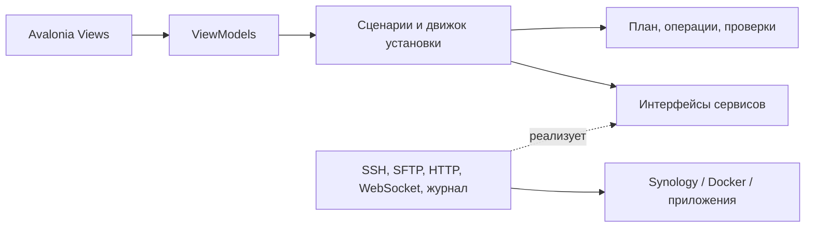

# hh-homelab-wizard

Визуальный помощник для установки [hh-homelab](https://github.com/hhypest/hh-homelab) на Synology NAS. Приложение планируется на **C# / Avalonia / MVVM**, с запуском на **Windows и Linux** и подключением к NAS по SSH.

**Состояние на 11 октября 2026 года: начат M1, M0 остаётся открытым.** Есть C#-ядро, диагностические инструменты и демонстрационное Avalonia/MVVM-приложение в выбранном оформлении «Фокус». Каркас показывает план, прогресс, ожидание подтверждения, успех, ошибку, неизвестный исход и остановку на искусственном адаптере. К NAS он не подключается, автоматического установщика пока нет. Возможности ниже — требования к первому выпуску; [результаты M0](docs/m0/README.md) и [демонстрация M1](docs/m1/README.md) описывают фактическую готовность.

## Для кого и для чего

Мастер должен провести пользователя от подготовленного NAS до работающих Media и Home Assistant: проверить окружение, подобрать параметры установки, показать план, развернуть контейнеры, настроить приложения и интеграции, согласовать сущности и проверить результат.

Пользователь работает с понятными шагами и состояниями. Пароли, API-ключи и коды сопряжения вводятся локально; ручное редактирование YAML и массовое переименование сущностей не должны быть обычной частью установки.

## Границы первого полноценного выпуска

| Область | Решение |
| --- | --- |
| Компьютер пользователя | Windows 11 x64 и Ubuntu 24.04 LTS x64 / X11 и Wayland; первичные сборки `win-x64` и `linux-x64`; испытания обязательны на Windows и обоих сеансах Linux |
| Машина назначения | Synology DSM 7.x, базовая модель DS725+, подключение по SSH; первая аппаратная проверка запланирована на DSM 7.4.1-90080, указанной владельцем |
| Сценарий | Новая установка; возобновление собственной прерванной установки |
| Media | Контейнеры, первичная настройка аккаунтов, каталогов и связей приложений |
| Home Assistant | Контейнер, локальные интеграции, сущности, панель, проверка автоматизаций |
| Сеть и облака | Настройка роутера, VPN, внешнего доступа и облачных привязок не входит |
| Существующая установка | Диагностика и исправление чужой/ранее настроенной установки — после первого выпуска |

Новая установка не означает очистку NAS. Медиатека может уже существовать: мастер сохраняет её содержимое. Если найден действующий стек, базы приложений или конфликтующие контейнеры, мастер сообщает о конфликте и не превращает этот сценарий в скрытое обновление или сброс.

### Media

Базовый профиль включает **qBittorrent, Prowlarr, Radarr, Sonarr, FlareSolverr, Jellyfin и Seerr**. Требуется настроить:

- пользователя и права доступа к каталогам, общую структуру `/data`, папки фильмов, сериалов и загрузок;
- аккаунты и аутентификацию приложений, категории загрузок, подключение qBittorrent к Radarr/Sonarr;
- связь Prowlarr с Radarr/Sonarr, при необходимости — FlareSolverr;
- библиотеки Jellyfin и подключение Jellyfin, Radarr и Sonarr к Seerr;
- проверку запросов, импорта и воспроизведения с пользовательским тестовым материалом.

Индексаторы и их доступы выбирает пользователь. Мастер не должен сам добавлять случайные источники или начинать массовые загрузки.

### Home Assistant

Базовый профиль включает **Home Assistant Container, Docker Socket Proxy, Monitor Docker, Synology DSM, LG webOS, Android TV Remote, Google Cast, Jellyfin** и предусмотренные проектом прикладные интеграции Media.

Мастер должен включать нужные датчики DSM, назначать ожидаемые `entity_id`, связывать роли LG/GX1/Cast/Jellyfin с конкретными устройствами и устанавливать панель с явным набором сущностей. Лишние плееры сначала классифицируются; их отключение допускается только после проверки зависимостей.

Проверки охватывают конфигурацию, показания, управление и условия сценариев Jellyfin/YouTube. Облачные сценарии Алисы/Yaha Cloud/YandexStation не входят в обязательную готовность первого выпуска. Использование уже предоставленного вебхука уведомлений допустимо как отдельная опция; создание внешних ботов и аккаунтов не входит в установку. Если опция выключена, зависимые сценарии должны быть корректно исключены или отключены, а не оставлены с фиктивными секретами.

## План версии 2.0.0

Для 2.0.0 запланирован настраиваемый состав установки: опциональные Sonarr, Radarr и новый модуль Bazarr, возможность полностью исключить Home Assistant, выбор остальных поддерживаемых компонентов и согласованных связей. Для обработки защиты индексаторов предусмотрен выбор **FlareSolverr / Byparr / Solvearr / NoFlare** или отдельный режим **«Не использовать»**. Мастер должен проверять зависимости и формировать конфигурацию, план и отчёт только для выбранных функций. Первый полноценный выпуск сохраняет согласованный состав Media + HA; возможности 2.0.0 пока не реализованы.

После переноса необходимых профилей и документации в wizard и приёмки выпуска 2.0.0 репозиторий **hh-homelab** планируется перевести в архивное состояние. Разработка и инструкции установки продолжатся в **hh-homelab-wizard**. [Этапы, варианты установки и условия архивирования](docs/DEVELOPMENT_PLAN.md#12-версия-200-настраиваемый-стек-и-архив-hh-homelab) описаны в плане; архивирование сейчас не выполняется.

## Что остаётся за пользователем

Предварительно нужны установленная DSM, Container Manager/Docker, включённый SSH, доступная локальная сеть и учётная запись с правами на выбранные операции. Мастер проверит их и покажет недостающие условия; установка DSM и изменение сети не входят в его задачи.

Для подключения устройств могут потребоваться подтверждение на LG, PIN с экрана GX1, выбор устройства и запуск Jellyfin на приставке для появления клиента. Если выбран способ установки компонентов через HACS, возможна отдельная авторизация GitHub. Такие шаги отображаются в мастере как ожидающие действия пользователя, с сохранением прогресса.

## Предполагаемая последовательность экранов

1. Приветствие, выбор новой установки и профиля hh-homelab.
2. Подключение к NAS и подтверждение SSH-ключа сервера.
3. Проверка DSM, Docker, прав, места, портов и существующих ресурсов.
4. Каталоги, пользователь, порты и параметры Media.
5. Локальные доступы, устройства и параметры Home Assistant.
6. Обзор конкретного плана изменений.
7. Выполнение с прогрессом, ожиданием подтверждений и восстановлением связи.
8. Назначение ролей сущностям, настройка панели и функциональные проверки.
9. Итоговый отчёт, адреса сервисов и результаты проверки.

## Технический подход

- **C# и .NET 10 LTS** — целевая основа; точные версии SDK и пакетов фиксируются при создании решения.
- **Avalonia** — графический интерфейс; **CommunityToolkit.Mvvm** — базовый MVVM-инструментарий.
- Доменная модель и движок установки независимы от Avalonia. В `ViewModel` находятся состояние экрана и команды; SSH, HTTP и работа с файлами выполняются через сервисы.
- Через **SSH/SFTP** выполняются проверки NAS, передача файлов и управление Compose. Через **HTTP/WebSocket API** — настройка приложений и реестров Home Assistant.
- Установка выполняется по версионированному профилю, закреплённому на точный выпуск/commit hh-homelab. Исходная база для первого профиля: **v1.3.0**, commit `b05047b081f3543520582315002e359ef1d93e59`.
- Каждая операция имеет предварительные условия, проверку результата, таймаут, журнал и явно описанный способ восстановления. Повторный запуск не должен создавать дубликаты.



Сборки для пользователя должны включать .NET runtime: отдельная установка Python, Node.js или .NET не требуется. Linux всё равно нуждается в поддерживаемом графическом окружении и системных библиотеках; конкретная матрица дистрибутивов и упаковка проверяются до выпуска. Это не обещание работы на любом Linux.

## Документы

- [Детальный план разработки](docs/DEVELOPMENT_PLAN.md) — этапы, зависимости, критерии приёмки, тесты и открытые решения.
- [Правила работы агентов](AGENTS.md) — архитектура, изменения, секреты и проверки.
- [Участие в разработке](CONTRIBUTING.md) — процесс изменений и требования к PR.
- [История изменений](CHANGELOG.md) — только фактически внесённые изменения.
- [M0: результаты исследования](docs/m0/README.md) — покрытие всех 118 шагов, протокол проб API и открытые проверки.

## Сборка текущего ядра

Для разработки нужен .NET SDK **10.0.401**. Команды из корня репозитория:

```text
dotnet restore HhHomelab.Wizard.slnx --locked-mode
dotnet build HhHomelab.Wizard.slnx --no-restore --configuration Release
dotnet test HhHomelab.Wizard.slnx --no-build --configuration Release
dotnet run --project tools/HhHomelab.Wizard.ProfileCheck --no-build --configuration Release -- profiles/hh-homelab/1.3.0/research-profile.json
```

ProfileCheck проверяет исследовательский каталог, не устанавливает стек. Для проверки содержимого исходных файлов добавьте путь к checkout hh-homelab v1.3.0 вторым аргументом. Демонстрационный UI запускается отдельно:

```text
dotnet run --project src/HhHomelab.Wizard.Desktop --no-build --configuration Release
```

[Инструкция M1](docs/m1/README.md) содержит сценарии, команды self-contained публикации, Linux-зависимости и матрицу приёмки. CI выпускает пробные артефакты `win-x64`/`linux-x64` с runtime, без объявления релиза. Автоматическое применение конфигурации будет добавлено на последующих этапах.

Developer tools QbDockerProbe, ArrDockerProbe, MediaDockerProbe и HaDockerProbe проверяют bootstrap Media и API Home Assistant на собственных временных контейнерах. Подтверждены владелец/onboarding, HTTP/WebSocket, переименование по идентичности реестра, тестовая панель и первый [config flow Jellyfin](docs/m0/JELLYFIN_FLOW.md). Текущий набор содержит 512 unit/fixture-тестов и 8 headless UI-проверок. Native DesktopProbe отдельно проверяет окно и демонстрационные сценарии.

[Локальный профиль HA](docs/m0/HA_LOCAL_PROFILE.md) проходит полный YAML checker и десять сценариев шаблонов. [HaRuntimeProbe](docs/m0/HA_RUNTIME.md) запускает полный сервер с настоящим Docker Proxy/Monitor Docker, синтетическим Docker API, 40 Docker entities, отказами, уведомлением, 18 динамическими сценариями Script и restart. Отсутствующие устройства остаются Missing; CPU первого измерения — Unknown.

Добавлены [технический план десяти ролей и включение выбранных сущностей](docs/m0/HA_ENTITY_ROLES.md), с проверкой идентичности, родителей, restart/reload и потери ответа. Реальное включение и live state проверены на штатном helper; DSM и плееры — на технических фикстурах. [Полный объём и ограничения M0](docs/m0/README.md) приведены отдельно. Установщика NAS пока нет; GUI работает только с демонстрацией.

Добавлены [интерактивные USER flows DSM/LG/Android TV/Cast](docs/m0/HA_DEVICE_FLOWS.md): credentials, OTP, backup share, LG confirmation и PIN представлены отдельными шагами; неизвестный исход запрещает повторную отправку. Настоящий HA подтвердил начальные формы, LG confirmation form, создание Cast и сохранение после restart. Полное аппаратное сопряжение, показания и управление ещё не проверены.

Добавлены [явный выбор discovery flow и техническая проверка entry/device/identifier](docs/m0/HA_DISCOVERY_BINDING.md). Выбор сверяется перед сопряжением; проверка привязки различает Missing/Pending/Disabled/Mismatch/Ambiguous. Cast UUID и Android MAC не связываются с одной GX1 автоматически. Нативные формы/serializer проверены на синтетических metadata; завершение discovery на настоящем оборудовании пока не подтверждено.

Первый каркас M1 реализован: Application/Desktop, DI, MVVM, темы, навигация и демонстрационный сценарий. Следующий шаг — клиентская приёмка на Windows 11 и Ubuntu 24.04 / X11 и Wayland, включая запуск без установленного .NET, клавиатуру и масштабирование. M1 ещё не закрыт. [Условия начала M1](docs/adr/0004-m1-entry.md) отделены от полной приёмки M0; дополнительные HA/Media-контракты и аппаратные проверки M0 остаются открытыми.

Владелец выбрал [макет «Фокус»](docs/adr/0005-focus-ui.md): центральная колонка, горизонтальные этапы и одно главное действие на экране. [ADR 0006](docs/adr/0006-desktop-demo.md) фиксирует пакеты и границы демонстрации. По новому решению владельца Windows 10 исключена; остаются Windows 11 и Linux с X11/Wayland, [ADR 0007](docs/adr/0007-client-platforms.md). В Wayland-сеансе используется нативный backend с резервным переходом на X11 при недоступности compositor; базовый дистрибутив испытаний — Ubuntu 24.04 LTS x64.

## Лицензии

Код, тесты, конфигурация сборки и машинные профили мастера — [MIT](LICENSE). Авторские тексты документации, включая этот README, — [CC BY 4.0](LICENSES/CC-BY-4.0.txt), © 2026 hhypest.

Зависимости и импортируемые материалы hh-homelab сохраняют свои лицензии и сведения об авторах. При упаковке сторонних компонентов необходимо включать требуемые уведомления.

## Первичные источники

- [hh-homelab v1.3.0](https://github.com/hhypest/hh-homelab/tree/v1.3.0), [медиа-стек](https://hhypest.github.io/hh-homelab/media-stack.html), [Home Assistant](https://hhypest.github.io/hh-homelab/).
- [Avalonia: MVVM](https://docs.avaloniaui.net/docs/fundamentals/the-mvvm-pattern), [поддерживаемые платформы](https://docs.avaloniaui.net/docs/supported-platforms).
- [CommunityToolkit.Mvvm](https://learn.microsoft.com/en-us/dotnet/communitytoolkit/mvvm/), [.NET support policy](https://dotnet.microsoft.com/en-us/platform/support/policy/dotnet-core).
- [Home Assistant Container](https://www.home-assistant.io/installation/linux#install-home-assistant-container), [WebSocket API](https://developers.home-assistant.io/docs/api/websocket/).
