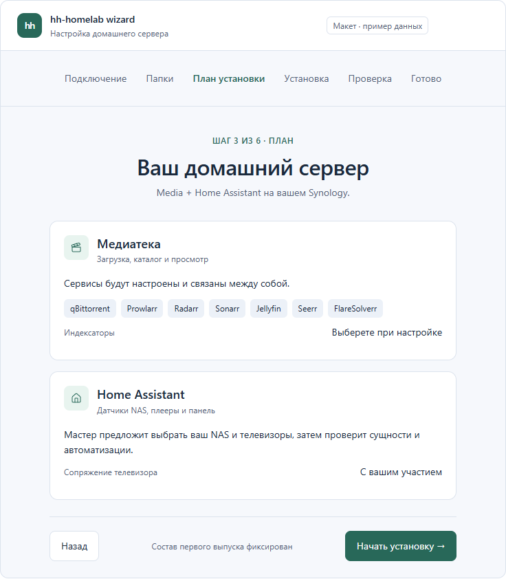

# ADR 0005: интерфейс мастера «Фокус»

Статус: принято владельцем 2026-10-11. Первоначальная пауза после выбора макета завершена новым заданием владельца; первый каркас M1 реализован по [ADR 0006](0006-desktop-demo.md). Этот ADR фиксирует само направление дизайна, не приёмку установщика.

## Основание

Владелец сравнил четыре интерактивных макета: «Пошаговый», «Фокус», «Контроль» и «Обзор». Выбран именно **«Фокус»**, без смешивания с другими вариантами. Указание владельца: «Выбор сделан — макет “Фокус”. Запиши этот выбор в репозиторий. Разработку, пока что, не начинай».

Согласованное направление — спокойный последовательный мастер с одним главным действием на экране. Макет показывает будущие состояния установки на демонстрационных данных; его успешные статусы не подтверждают готовность установщика или работу на NAS.

Изображение сохранено из согласованной визуализации. Оно является ориентиром оформления, не снимком уже реализованного приложения Avalonia.

## Компоновка

- Верхняя строка: знак `hh`, название `hh-homelab wizard` и подпись «Настройка домашнего сервера».
- Под верхней строкой — горизонтальная последовательность этапов с явно выделенным текущим шагом. Постоянной боковой навигации нет.
- Основное содержимое — одна центральная колонка, ориентир ширины около 640 логических пикселей. Короткий номер/название этапа, крупный заголовок и пояснение расположены над содержимым.
- На экране плана карточки «Медиатека» и «Home Assistant» расположены друг под другом. Состав сервисов и необходимость участия пользователя видны до запуска.
- Внизу — второстепенное действие «Назад» и одна основная кнопка продолжения. В рабочем сценарии доступность переходов определяется состоянием установки; возможность свободно открывать экраны в макете относится только к демонстрации.
- Технические подробности раскрываются по запросу. Основной экран содержит понятное описание состояния и конкретное следующее действие.

## Визуальные ориентиры

Это ориентиры согласованного макета. Первый каркас M1 использует их в ресурсах Desktop; изображение выше сохраняет исходный макет, отдельно от рендеров приложения.

| Элемент | Ориентир |
| --- | --- |
| Акцент | Спокойный зелёный: `#286859` в светлой теме, `#94d8c3` в тёмной |
| Текст на основной кнопке | `#ffffff` в светлой теме, `#152e27` в тёмной |
| Фон окна | `#f6f8fc` / `#10151f` |
| Поверхности карточек | `#ffffff` / `#18202d` |
| Основной текст | `#1b293c` / `#e7edf6` |
| Скругление карточек | Около 12 логических пикселей |
| Отступы | Ритм 8 пикселей, основные интервалы 16/24/32 |
| Типографика | Системный читаемый шрифт, крупный заголовок около 32 пикселей, основной текст около 14 |

Светлая и тёмная темы, масштабирование, фокус клавиатуры и длинные русские подписи учитываются при реализации. Числа из макета не заменяют проверку читаемости на Windows 10/11 и Ubuntu/X11. На узком окне содержимое перестраивается без обрезки основных действий.

## Состояния и поведение

1. **Подключение:** адрес NAS и пользователь SSH, понятная ошибка ввода, проверка окружения. Отпечаток SSH host key подтверждается явно; макет не заменяет эту проверку.
2. **План:** сводка Media + Home Assistant, место установки и шаги с участием пользователя. Свободный выбор компонентов не добавляется в первый выпуск этим решением; кастомизация остаётся в плане 2.0.0.
3. **Выполнение:** текущая операция и проверяемый прогресс. Повторное нажатие не создаёт вторую сессию.
4. **Ожидание пользователя:** одно конкретное действие — например, подтверждение на телевизоре или ввод PIN. Подтверждение пользователя затем проверяется адаптером; оно само по себе не означает успех сопряжения.
5. **Ошибка или неизвестный результат:** понятное объяснение, сохранённый контекст и доступная проверка состояния. Неизвестный исход не разрешает слепой повтор записи.
6. **Остановка:** отличается от отката. Экран объясняет, что уже выполненные изменения остаются и последняя операция могла завершиться после отмены ожидания.
7. **Результат:** показывает только фактически подтверждённые проверки; отсутствующие устройства, ожидание измерения и непроверенные функции не становятся успешными статусами.

## Граница этого решения

Этот ADR фиксирует выбранное визуальное направление и требования к будущим экранам. Он не добавляет Application/Desktop, Avalonia-зависимости, Views/ViewModels или установочные операции и не закрывает M0/M1.

[Условия начала M1](0004-m1-entry.md) сохраняются. Первый инкремент M1 после нового задания владельца реализует выбранную компоновку на искусственном адаптере с явным демонстрационным режимом. SSH, установка Media и реальная настройка HA подключаются на соответствующих последующих этапах.

Документ: [CC BY 4.0](../../LICENSES/CC-BY-4.0.txt), © 2026 hhypest.
