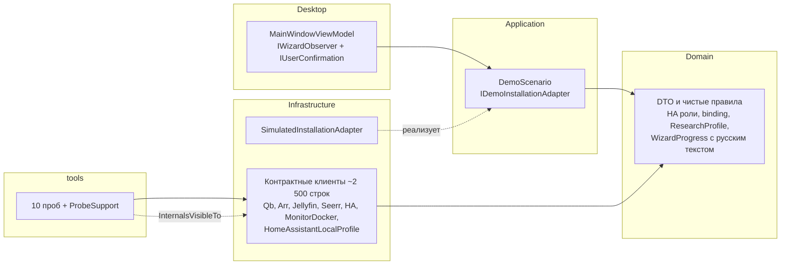

# hh-homelab-wizard: code review и архитектурный аудит

| | |
| --- | --- |
| Репозиторий | `hhypest/hh-homelab-wizard`, ветка `main` |
| Проверенный commit | `43f1a99` (Merge PR #95), 11.10.2026 |
| Объём | весь репозиторий: 163 файла, `src/`, `tests/`, `tools/`, `profiles/`, `docs/`, CI, ADR |
| Что сделано руками | чтение всего C#-кода и документов; `restore --locked-mode` → `build -c Release` → `test` → `ProfileCheck` на .NET SDK 10.0.401 (Linux); замер покрытия (`dotnet-coverage`); отдельный эксперимент для проверки таймаутов HTTP; сверка YAML-трансформаций с upstream `hh-homelab@b05047b` |
| Что не запускалось | Docker-пробы (`*DockerProbe`, `HaRuntimeProbe`) — в среде аудита нет Docker daemon; GUI на реальных Windows 11 / Ubuntu; статус CI в GitHub Actions не проверялся |

---

## 0. Коротко

**Оценка проекта: 7 из 10 для текущей стадии.** Инженерная дисциплина очень высокая: воспроизводимая сборка, работа с неизвестным исходом операций, гигиена секретов, 520 зелёных тестов и около 90 % покрытия. Установщика при этом пока нет: SSH, плана, журнала и движка операций в коде нет. Главные риски не в отдельных строках кода. Их четыре:

1. **Архитектурный разрыв.** Около 2,5 тыс. строк «контрактных клиентов» живут в Infrastructure, не стоят за портами Application и хранят «намерения» операций в памяти. Будущий движок с журналом (ADR 0002, M3) потребует их заметно переделать.
2. **Профиль зашит в код.** Версии, `entity_id`, имена контейнеров и количество библиотек записаны строковыми константами в C#. Это противоречит идее версионированного профиля и прямо помешает 2.0.0 с настраиваемым составом.
3. **Читаемость.** Код очень плотный: несколько операторов в строке, 366 строк длиннее 160 символов, нет `.editorconfig` и форматтера. Сопровождать его человеку тяжело.
4. **Процесс и документы.** Примерно 13,7 тыс. слов документации на 3,2 тыс. строк продуктового кода. Статусы дублируются в 6–7 файлах и уже расходятся.

Найдена одна системная ошибка средней тяжести, воспроизведена: таймаут `HttpClient` в клиентах qBittorrent/Arr/Jellyfin/Seerr выглядит как отмена пользователем. Для записей это нарушает ключевое правило проекта «потерянный ответ = результат неизвестен» (раздел 4, **B1**).

### Сводная оценка

| Область | Оценка | Комментарий |
| --- | :---: | --- |
| Сборка, зависимости, CI | **9/10** | SDK и пакеты закреплены, lock-файлы, `--locked-mode`, actions по SHA, матрица Windows/Ubuntu, runtime-пробы на настоящих контейнерах |
| Безопасность и supply chain | **8.5/10** | Секреты не попадают в исключения и логи, `ArgumentList` вместо shell, SHA-256 lock для Monitor Docker, защита от zip-slip, TLS не отключается |
| Корректность контрактных клиентов | **7.5/10** | Строгое наблюдение до и после записи, без слепых повторов. Системная ошибка таймаутов вне HA и несколько мелких |
| Тесты | **8.5/10** | 512 unit/fixture + 8 headless UI, около 88–100 % строк по слоям, инъекция потери ответа |
| Архитектура (готовность к M2/M3 и 2.0) | **6/10** | Слои есть формально. Портов, модели операций и data-driven профиля нет |
| Читаемость и сопровождаемость | **5/10** | Плотный код, «god class» HA на ~1 200 строк, дублирование транспорта и констант |
| UI/MVVM (для демо) | **6.5/10** | Чисто для демонстрации, но один ViewModel на все экраны не масштабируется до 9 экранов |
| Документация и процесс | **6.5/10** | Честные и подробные ADR и протоколы, но объём, дублирование и устаревшие цифры |
| Продуктовая готовность к v1.0 | **≈10–15 %** | Грубая оценка: M0 частично, M1 частично, критический путь M2–M3 (SSH → план → журнал → исполнитель) не начат |

---

## 1. Что это за проект в цифрах

| Метрика | Значение |
| --- | --- |
| История | 46 коммитов за 10–11 октября 2026, PR-процесс, ≈76 Issues (15 эпиков) в 10 Milestones |
| C# | `src/` 3 240 строк, `tests/` 3 738, `tools/` 1 802 (+3 Python-фикстуры для стендов) |
| Проекты | 4 продуктовых (Domain, Application, Infrastructure, Desktop), 2 тестовых, 10 проектов в `tools/` |
| Тесты | 236 тестовых методов → 512 кейсов UnitTests + 8 DesktopTests, все зелёные (локально, Linux) |
| Покрытие строк | Application 100 %, Domain 89 %, Infrastructure 88 %, Desktop 92 % (`dotnet-coverage`) |
| Предупреждения сборки | 0 (при `TreatWarningsAsErrors=true`) |
| Документация | ≈13,7 тыс. слов Markdown: README, AGENTS, CONTRIBUTING, CHANGELOG, план, roadmap, правила Project, 7 ADR, 9 протоколов M0, 2 документа M1 |

AGENTS.md, коммиты по замечаниям Codex и темп (≈8,8 тыс. строк C# и ≈76 Issues за два дня) показывают, что проект ведётся с активным участием ИИ-агентов. Это объясняет и сильные стороны (дисциплина, тесты, оборонительный стиль), и слабые (плотный однострочный код, объём и повторяемость документов). Ниже это учтено в рекомендациях.

---

## 2. Сильные стороны

Их стоит сохранить при любой переработке.

1. **Модель «неизвестного исхода» продумана на уровне, редком даже для коммерческого кода.** Намерение фиксируется до записи, затем результат наблюдается заново. Повтора после потерянного ответа нет (`HomeAssistantContractClient.Devices.cs`, `...Jellyfin.cs`, `QbittorrentConfiguration.ChangeCredentialsAsync`). Отмена и откат явно различаются и в коде, и в UI-текстах.
2. **«Observe → write → observe» во всех клиентах.** Каждая мутация сначала читает состояние: конфликт означает отказ, совпадение означает `false` («уже сделано»). После записи результат проверяется независимым чтением (`EnsureRootFolderAsync`, `EnsureCategoryAsync`, `EnsureLibraryAsync`, `EnsureDashboardAsync`). Это правильный фундамент для идемпотентного установщика.
3. **Отказ «присваивать» чужое.** Клиенты отклоняют чужие download clients, applications, библиотеки и config entries вместо того, чтобы их перехватывать. Проверяется предварительная аутентификация контекста (`qb.authentication.context-preauthenticated`, `seerr.authentication.context-preauthenticated`).
4. **Гигиена секретов:**
   - коды ошибок без тел ответов и URL;
   - `HomeAssistantLocalSettings` сделан `class`, а не `record`, чтобы автоматический `ToString()` не печатал секреты;
   - credentials в пробах передаются через stdin;
   - `secrets.yaml` в TAR получает права `0600`;
   - `http_check.py` из upstream принудительно переводится на проверку TLS;
   - refresh-токены HA отзываются через `IAsyncDisposable`.
5. **Supply chain:**
   - `global.json` с `rollForward: disable`;
   - Central Package Management и lock-файлы, `--locked-mode` в CI;
   - GitHub Actions закреплены по SHA, `permissions: contents: read`;
   - Monitor Docker скачивается по точному commit, сверяется с SHA-256 lock на 39 файлов, с ограничением размера архива и файлов, запретом `..`/`\`/`:` и проверкой типа записи ZIP.
6. **Docker-стенды для проб аккуратны:**
   - только локальный context, `DOCKER_HOST` запрещён;
   - ресурсы помечены label сессии;
   - перед удалением проверяется владение и отсутствие bind/чужих volume;
   - процессы запускаются через `ProcessStartInfo.ArgumentList` без shell;
   - у cleanup отдельные дедлайны.
7. **Тесты проверяют поведение, а не реализацию.** Потеря ответа на каждом шаге, отказы, конфликты идентичности, отсутствие секретов в сообщениях исключений. Runtime-пробы в CI гоняются дважды на свежих контейнерах.
8. **Domain и Application не зависят от Avalonia и транспорта.** Desktop использует compiled bindings и DI с `ValidateOnBuild`. Platform startup вынесен в общий `DesktopPlatform` и проверяется на Win32, X11, Wayland и fallback.
9. **Честные ADR и протоколы.** Документы последовательно разделяют fixture, Docker, CI GUI, клиентскую и аппаратную проверки и не выдают одно за другое.

---

## 3. Архитектурный аудит

### 3.1. Заявленная и фактическая архитектура

README и ADR 0001 описывают такую схему: ViewModels → сценарии Application → порты ← реализации Infrastructure. Фактически зависимости устроены так:



Выводы:

- **Application содержит только демо** (`DemoScenario.cs`, 73 строки). Ни одного порта для настоящих операций нет. Вся предметная работа находится в Infrastructure, и её напрямую вызывают tools.
- **Контрактные клиенты одновременно транспорт и сценарий.** Например, `JellyfinContractClient.BootstrapAsync` содержит последовательность шагов мастера: администратор → локаль → удалённый доступ → завершение. `HomeAssistantLocalProfile.RenderAsync` — это «компилятор профиля», то есть логика Application/Domain, помещённая в Infrastructure.
- **Состояние операций хранится внутри клиентов:** `jellyfinIntent`, `deviceIntents`, `httpIntent`, `stagedGeneration`, `verifiedConnections`. ADR 0002 требует, чтобы намерение и подтверждение жили в атомарном версионированном журнале и переживали перезапуск. Значит, при переходе к M3 это состояние нужно вынести из клиентов, иначе журнал и клиенты будут расходиться.
- **Domain смешивает уровни.** Чистые правила (`HomeAssistantRolePlanner`, `HomeAssistantDeviceBindingVerifier`) лежат рядом с DTO конкретного API и с `WizardProblem.Message` на русском языке. Пользовательский текст — забота Desktop.

### 3.2. Архитектурные находки

#### A1. Нет модели операций и движка. **Риск: высокий**

Сейчас есть `enum WizardOperation` (6 демонстрационных групп) и разрозненные методы `Ensure*`. В README и плане названы `InstallationPlan`, `InstallationOperation`, `JournalCheckpoint`, `StepResult`, но ни одного из них нет даже в виде интерфейса. Каждый клиент по-своему кодирует итог: `bool changed`, исключение с суффиксом `.result-unknown`, enum-стадии (`HomeAssistantDeviceSetupStage`, `HomeAssistantJellyfinStage`, `HomeAssistantHttpStage`, `HomeAssistantEnableStage`).

**Рекомендация:** до продолжения работы над M0-контрактами ввести в Application единый контракт операции и типизированный итог записи. Тогда клиенты станут адаптерами без собственного «долгого» состояния:

```csharp
// Application
public abstract record WriteOutcome
{
    public sealed record Applied : WriteOutcome;
    public sealed record AlreadySatisfied : WriteOutcome;
    public sealed record Rejected(ErrorCode Code) : WriteOutcome;      // доказанный отказ: можно исправить ввод
    public sealed record Unknown(ErrorCode Code) : WriteOutcome;       // только Observe, никаких повторов
}

public interface IInstallOperation
{
    OperationId Id { get; }
    ResourceRef Resource { get; }
    Task<Observation> ObserveAsync(OperationContext ctx, CancellationToken ct);
    Task<WriteOutcome> ApplyAsync(OperationContext ctx, Observation before, CancellationToken ct);
    Task<Verification> VerifyAsync(OperationContext ctx, CancellationToken ct);
}

// Engine: journal.Intent(op, before) → ApplyAsync → VerifyAsync → journal.Confirm(op, verification)
```

#### A2. Профиль зашит в код. **Риск: высокий для 2.0.0, средний для v1**

Одни и те же факты записаны в нескольких местах:

| Факт | Где записан |
| --- | --- |
| Версия HA `2026.10.0` | 4 раза в `src`, ещё 10 раз в tools/CI/profile |
| Версии Qb/Arr/Jellyfin/Seerr | `ArrContractClient.PinnedVersion`, строки в `QbittorrentContractClient`, `JellyfinContractClient`, `SeerrContractClient`, плюс `research-profile.json` и `ci.yml` |
| Целевые `entity_id` (`sensor.ds725_*`, `media_player.rocktek_gx1` …) | `Domain/HomeAssistantRoles.cs:23-35` и повторно `Infrastructure/HomeAssistantContractClient.Runtime.cs:10-13` |
| Имена контейнеров | `HomeAssistantContractClient.Runtime.cs:10` |
| Ровно две библиотеки и ровно два Arr | `SeerrContractClient.EnsureLibrariesAsync` (`expected.Count != 2`), `CompleteSetupAsync` (`verifiedConnections.Count != 2`) |
| Трансформации YAML по строковым якорям | `HomeAssistantLocalProfile.cs:49-61` |
| Маппинг интеграция → домен HA | `HomeAssistantDeviceBindingVerifier.Domain` и `HomeAssistantContractClient.DeviceDomain` (дубль) |

Для v1 с фиксированным составом это терпимо. Но 2.0.0 (опциональные Radarr/Sonarr/HA, Bazarr, выбор обработчика) требует, чтобы состав, роли, версии и связи выводились из профиля. Сейчас каждое такое место придётся искать вручную. Есть и скрытый риск рассинхрона: CI скачивает образы по своему списку, клиенты проверяют свои строки, профиль хранит третью копию, и нигде не проверяется, что они совпадают.

**Рекомендация:**

- Расширить схему профиля: `components[]` с `version` и `apiContract`, `roles[]`, `transforms[]`.
- Передавать в клиенты ожидаемую версию из профиля, а не константу.
- Добавить тест «все pin в `ci.yml` совпадают с профилем» или генерировать список образов для CI из профиля.
- Сразу перестать называть роли по модели устройства (`ds725_`, `rocktek_gx1`) и сделать их параметрами профиля.

#### A3. `HomeAssistantContractClient` — «god class». **Риск: средний**

Это один `partial class` в 6 файлах, около 1 200 строк. В нём смешаны аутентификация и сессии, onboarding, реестры, dashboards, HTTP-конфигурация, config flow Jellyfin, flow четырёх устройств, discovery, разбор runtime-состояний и **вспомогательные методы для фикстур** (`CreateProbeHelperAsync`, `GetProbeSessionCountAsync`, `RefreshDockerDownProbeAsync`, `NotifyLocalProfileProbeAsync`, `DisableProbeHelperAsync`, `IsProbeHelperAvailableAsync`). Фикстурные методы попадают в продуктовую сборку и открыты пробам через `InternalsVisibleTo`.

**Рекомендация:** разделить на `HaSession` (auth, refresh, revoke, WebSocket), `HaOnboarding`, `HaRegistry`, `HaDashboards`, `HaHttpConfig`, `HaConfigFlows` (общий движок flow и описания шагов Jellyfin, DSM, LG, Android TV, Cast) и `HaRuntimeReader`. Фикстурные методы перенести в `ProbeSupport` поверх публичного «низкоуровневого» `HaSession.CommandAsync`, доступного только сборке проб.

#### A4. Четыре реализации HTTP-транспорта и три одинаковых исключения. **Риск: средний**

`QbittorrentConfiguration.PostFormAsync/ReadJsonAsync`, `ArrContractClient.ReadAsync/SendAsync`, `MediaContractTransport.ExchangeAsync` и `HomeAssistantContractClient.HttpContentAsync` делают одно и то же, но с разной обработкой ошибок. Отсюда системная ошибка **B1**. `QbittorrentContractException`, `ArrContractException` и `MediaContractException` идентичны по форме, причём HA-клиент бросает `MediaContractException`. `ArrContractClient.ValidateEndpoint` используется как общий helper в Jellyfin, Seerr и HA.

**Рекомендация:** один `ContractTransport` с дедлайном, классификацией «чтение/запись», маппингом в `WriteOutcome`/коды и одним `ContractException(ErrorCode, HttpStatusCode?)`. Набросок в B1.

#### A5. Ошибки — строки без каталога. **Риск: средний**

Коды (`"ha.ws.result-unknown"`, `"arr.provider.conflict"` …) разбросаны литералами, а семантика «неизвестно/отказ/транспорт» закодирована суффиксом строки. Тесты сравнивают строки. Для UI понадобится маппинг кода в понятный русский текст и следующее действие. Без каталога это сотни разрозненных литералов, и опечатка в коде не ловится компилятором.

**Рекомендация:** `ErrorCode` как `readonly record struct` с константами по областям или source generator из одного списка. Отдельное поле `Kind {Rejected, Unknown, Transport, Conflict, Invalid}` вместо суффикса. Русские тексты держать в ресурсе Desktop.

#### A6. Критический путь не начат: SSH/SFTP, preflight, журнал. **Риск: высокий**

M0 ушёл вглубь (discovery-flow DSM/LG/Cast, 18 сценариев скриптов HA), но SSH-библиотека не выбрана и нет ни одной операции на NAS. Самые неопределённые места (DSM ACL, sudo, Container Manager/compose, пути `/volume1`, права PUID/PGID) остаются непроверенными, а контракты HA уже детализированы.

**Рекомендация: walking skeleton** до продолжения M0-исследований. Сквозной сценарий: SSH (host key) → read-only preflight → план → журнал → развернуть **один** сервис (qBittorrent) через compose → настроить через существующий клиент → прервать → продолжить. Это проверит модель A1 на реальном пути и покажет, что придётся менять в клиентах, пока их меньше.

#### A7. UI-архитектура рассчитана на демо. **Риск: низкий сейчас, средний к M2**

Один `MainWindowViewModel` со `enum WizardPage`, текстами всех экранов и флагами `IsConnection`/`IsPlan`…; VM сам реализует `IWizardObserver` и `IUserConfirmation`. Для 9 экранов из README это превратится в монолит.

**Рекомендация:** ViewModel на экран, `INavigationService` или ViewLocator, `IProgress<WizardProgress>`/канал событий вместо реализации интерфейсов сценария во VM. Интерактивные шаги (PIN, подтверждение на ТВ, OTP) оформить как типизированные запросы `IUserInteraction.RequestAsync<TInput>(InteractionRequest)`: таких шагов в M5 будет много.

#### A8. Объём продукта привязан к одной конфигурации. **Риск: продуктовый**

DS725+, LG webOS, Rocktek GX1, конкретные `entity_id` — фактически это конфигурация одного дома. Как личный инструмент это нормально. Для публичного мастера и тем более для 2.0.0 стоит уже сейчас проектировать роли и устройства как параметры. Тогда не придётся переписывать M6 после первого выпуска.

---

## 4. Code review: конкретные находки

Важность: **High** — может привести к неверному действию на NAS или потере данных; **Medium** — нарушает принятые инварианты проекта или вызовет ошибку в штатном сценарии; **Low** — качество и сопровождаемость.

### B1. Medium — таймаут `HttpClient` выглядит как отмена пользователем; записи не получают `result-unknown`

**Где:**
- `QbittorrentConfiguration.cs:111-138`
- `QbittorrentContractClient.cs:22-70`
- `ArrContractClient.cs:200-224`
- `MediaContractTransport.cs:24-41` (используется Jellyfin и Seerr)

**Суть.** По истечении `HttpClient.Timeout` .NET бросает `TaskCanceledException`, хотя токен вызывающего не отменён. В этих клиентах ловится только `HttpRequestException`/`JsonException`, поэтому:
- для **чтений** наружу уходит «голое» `TaskCanceledException`;
- для **записей** (`setPreferences`, `createCategory`, `rootfolder`, `downloadclient`, `Startup/User`, `settings/radarr` …) вызывающий получает «отмену» вместо `*.result-unknown`.

Будущий движок не сможет отличить «пользователь нажал Стоп» от «запрос мог примениться». Это прямое нарушение ADR 0002. В HA-клиенте ошибка уже исправлена (`HomeAssistantContractClient.cs:360-380`, тест `HttpTransportTimeoutDoesNotMasqueradeAsCallerCancellation`), в остальных клиентах — нет.

**Проверено экспериментом:** обработчик, который никогда не отвечает, и `HttpClient.Timeout = 200 мс`:

```text
Arr GET:      TaskCanceledException (caller token NOT cancelled)
Seerr GET:    TaskCanceledException (caller token NOT cancelled)
Jellyfin GET: TaskCanceledException (caller token NOT cancelled)
Qb login:     TaskCanceledException (caller token NOT cancelled)
```

Сейчас пробы задают `Timeout` 10–30 с, так что сценарий реален.

**Исправление:** единый транспорт (A4) по образцу HA. Дедлайн задаётся связанным токеном, `HttpClient.Timeout = InfiniteTimeSpan` требуется от вызывающего или выставляется в фабрике. Плюс тесты «timeout на чтении → transport-failed» и «timeout на записи → result-unknown» для каждого клиента.

```csharp
catch (OperationCanceledException) when (!token.IsCancellationRequested)
    => throw new ContractException(code, write ? ErrorKind.Unknown : ErrorKind.Transport);
```

### B2. Medium — `HttpRequestException` не нормализуется в части клиентов qBittorrent

**Где:** `QbittorrentContractClient.LoginAsync` (preflight и login), `GetVersionAsync`, `QbittorrentConfiguration.ReadJsonAsync`.

**Суть.** При обрыве соединения наружу выходит сырое `HttpRequestException` вместо `qb.*.transport-failed` или `result-unknown` (для login). Контракт «наружу выходят только коды» нарушается. Сообщение может содержать host:port (секретов там нет). Исправляется тем же единым транспортом.

### B3. Low/Medium — доказанный отказ (4xx) при отправке шага flow навсегда делает исход «неизвестным»

**Где:** `HomeAssistantContractClient.Devices.cs:163-164` (`intent.Unknown = true` до POST) и `:114`. Аналогично `...Jellyfin.cs:57-58`.

**Суть.** Если POST шага вернул 400/401/403, `HttpAsync` бросает `*.http-error`, а `intent.Unknown` остаётся `true`. Дальше `ObserveDeviceSetupAsync` сразу возвращает `OutcomeUnknown`, даже без GET. Исправить ввод (неверный хост или PIN-формат, отклонённый схемой) в рамках того же клиента нельзя. Консервативность здесь — сознательное решение. Но `400 Invalid user input` у HA означает, что шаг не выполнялся. **Рекомендация:** различать доказанный отказ (4xx до обработки шага) и неизвестный исход, сбрасывать `Unknown` для явного 4xx и покрыть это тестом.

### B4. Low — `ArrDownloadConnection.IsValid` пропускает невалидные хосты

**Где:** `Domain/ArrService.cs:8-10`.

Проверяется только алфавит, поэтому `"-..-"`, `"."` и `"a..b"` считаются валидными (`new ArrDownloadConnection("-..-", 8080, "movies").IsValid() == true` — проверено). В других местах используется `Uri.CheckHostName`. Для единообразия нужен общий `HostName.TryParse` в Domain.

### B5. Low (латентно) — удаление строк-комментариев YAML «по строкам»

**Где:** `HomeAssistantLocalProfile.cs:47-48`.

Удаляются все строки, начинающиеся с `#`. Внутри block scalar (`|`, `>`) такая строка — данные (Markdown-заголовок в уведомлении, shell-комментарий в `command_line`). **Для закреплённого v1.3.0 это безопасно:** я сравнил семантику всех 7 файлов до и после удаления через YAML-парсер — результаты идентичны. Но правило не переживёт новые профили. **Рекомендация:** либо не удалять комментарии (зачем — не задокументировано), либо удалять только вне block scalar, а в тест профиля добавить проверку семантической эквивалентности.

### B6. Low — строковые замены YAML по «якорям» хрупкие

**Где:** `HomeAssistantLocalProfile.cs:49-61`.

`ReplaceExact` с ожидаемым числом вхождений — хорошая защита: при изменении источника операция падает, а не тихо портит файл. Но трансформации вроде `"  internal_url: \"http://192.168.3.53:8123\""` — это код, привязанный к одному commit. **Рекомендация:** вынести трансформации в профиль (`transforms[]` с `file`, `anchor`, `count`, `replacement` из параметров) и тестировать как данные. Это подготовка к 2.0.0, где файлы будут генерироваться по выбранному составу.

### B7. Low — неявные значения по умолчанию у координат

**Где:** `HomeAssistantLocalSettings` (`Latitude`, `Longitude`, `Elevation`) не `required`. Пропуск даёт `0/0/0` («Null Island»), и `Validate` это пропускает. Сделать `required` или явно запрещать `(0, 0)`.

### B8. Low — подделка пароля для валидации

**Где:** `HomeAssistantContractClient.Jellyfin.cs:27`, `Credentials(username, "validation-only")`.

Валидатор пары вызывается с фиктивным паролем, чтобы проверить только имя. Нужен отдельный `ValidateUsername`. Там же разные правила длины пароля: qBittorrent ≥ 6 (`QbittorrentConfiguration.cs:48-50`), остальные ≥ 8 (`MediaJson.Credentials`). Правила стоит собрать в одном месте и обосновать требованиями каждого сервиса.

### B9. Low — дублирование констант и правил

- `DeviceDomain` (`Devices.cs:299-304`) дублирует `HomeAssistantDeviceBindingVerifier.Domain` (`HomeAssistantDeviceBinding.cs:63-68`).
- Список аппаратных `entity_id` повторён в `HomeAssistantRoles.cs` и `...Runtime.cs`.
- Число `6` захардкожено в `DemoScenario.cs` (строки 43, 47, 51, 56, 61, 67) и в `MainWindowViewModel.cs:52-53` (`"из 6"`, `/ 6`). Его нужно брать из `Enum.GetValues<WizardOperation>().Length` или из плана.
- Валидация `/data`-путей (`QbittorrentDownloadSettings.IsDataPath` + `StartsWith("/data/media/")`) повторяется в `MediaLibrary`, `SeerrArrConnection` и `ArrContractClient`. Нужен value object `DataPath`.

### B10. Low — UI-тексты в Domain и Infrastructure

`WizardProblem(Code, Message, Diagnostic)` в Domain и русские строки в `SimulatedInstallationAdapter` и `DemoScenario`. Слой-источник должен отдавать код и параметры, текст выбирает Desktop. Это нужно и для будущей локализации, и для единообразия сообщений.

### B11. Low — мелочи в Desktop

- `MainWindow.OnClosing` — `async void`. Сейчас `CloseAsync` не бросает (всё ловится в `RunAsync`), но защитный `try/catch` с принудительным закрытием окна стоит добавить.
- `NotifyState()` на каждое изменение поднимает 14 `PropertyChanged` и 6 `NotifyCanExecuteChanged`. Для демо это не страшно, но признак того, что вычисляемые свойства пора разнести по VM экранов (A7).
- Поля ввода связаны с подписями только через `AutomationProperties.Name`. Для экранного диктора лучше `AutomationProperties.LabeledBy` на соответствующий `TextBlock`.

### B12. Low — ресурсы

`HomeAssistantConnection` не освобождает `SemaphoreSlim gate`. `GetManifestResourceStream(...)!` с `!` вместо понятного исключения (`HomeAssistantLocalProfile.cs:30`, `OwnedDockerBench.*`).

### B13. Info — стиль кода

- Несколько операторов на строке (`ArgumentNullException.ThrowIfNull(a); ArgumentNullException.ThrowIfNull(b);`, `this.http = http; this.service = service; …`).
- Длинные `switch`-выражения в одну строку (`MainWindowViewModel.Title`, `ResultMessage`).
- 366 строк длиннее 160 символов, 26 строк длиннее 200 в `src`.
- Нет `.editorconfig`; `AnalysisLevel=latest` без `AnalysisMode` (по умолчанию включено немного правил); нет `dotnet format --verify-no-changes` в CI.

Для проекта, который должен читать и ревьюить человек, это главный фактор стоимости сопровождения.

---

## 5. Тесты и CI

**Хорошо:**
- Fake `HttpMessageHandler` и `IHomeAssistantSocket` с инъекцией потери ответа на конкретном шаге; проверки, что секреты не попадают в `Exception.Message`.
- Headless UI-тесты через реальный composition root.
- Native probe проверяет фактический backend окна (Win32, X11, Wayland и fallback).
- В CI 6 runtime-задач на настоящих образах, каждая гоняется дважды на свежих контейнерах.

**Улучшить:**
- В каждом тестовом файле свой fake-handler: `Fixture`, `ApiFixture`, `UiFixture`, `ProbeHandler` и т. д., всего 7 реализаций. Нужен общий `ScriptedHttpHandler` (маршрут → ответ или исключение, «потерять ответ после применения», журнал запросов) в общей тестовой библиотеке.
- Нет тестов таймаута для Media/Arr/Qb (B1) и тестов «4xx на шаге flow» (B3).
- `HomeAssistantLocalProfile.RenderAsync` покрыт unit-тестами на 27 %, `MonitorDockerPackage` на 57 %. Основная проверка идёт через Docker-пробы, но unit-тест рендера на закоммиченной копии исходников (fixture) был бы дешевле и стабильнее.
- В CI нет:
  - Dependabot/Renovate для `github-actions` и NuGet — при закреплении по SHA и lock-файлах без него pin быстро устаревают;
  - отчёта покрытия;
  - `dotnet format`;
  - CodeQL (опционально).
- Runtime-пробы привязаны к `lscr.io`/`ghcr.io` без ретраев pull. Нестабильность registry будет ронять PR. Стоит добавить ретрай pull или кэш образов.

---

## 6. Безопасность

| Тема | Состояние | Рекомендация |
| --- | --- | --- |
| Секреты в логах и исключениях | Хорошо: коды без тел, тесты на утечки | Сохранить при рефакторинге транспорта |
| Секреты в памяти | `string` в полях клиентов (`accessToken`, `refreshToken`, API-ключи) | Для настольного клиента приемлемо. Ограничить время жизни и не держать в singleton дольше сессии. Выбор хранилища (DPAPI / Secret Service) уже запланирован в ADR 0002 |
| Shell injection | Пробы используют `ArgumentList`; SSH ещё нет | При появлении SSH передавать параметры через stdin/файлы, команды держать фиксированными (как и требует AGENTS.md) |
| TLS | Не отключается; `http_check.py` исправляется в сторону проверки | Для DSM с самоподписанным сертификатом нужен явный сценарий pinning/доверия, иначе пользователь застрянет. Стоит продумать до M5 |
| Токен Jellyfin в HA | В `secrets.yaml` уходит `MediaBrowser Token=…` | Использовать отдельный API-ключ или пользователя с минимальными правами, а не сессию администратора |
| Supply chain | Отлично (pin, lock, SHA-256) | Добавить автоматическое обновление pin (Dependabot) с ревью |
| Загрузка Monitor Docker | Проверяется полностью | Хорошо. При переходе к доставке на NAS сохранить те же проверки и атомарную замену каталога |

---

## 7. Документация и процесс

**Сильное:** ADR короткие и по делу. Протоколы M0 честно фиксируют «что доказано и чем». Лицензирование аккуратное: MIT для кода, CC BY 4.0 для текстов, уведомления сторонних компонентов собираются в артефакт.

**Проблемы:**

1. **Объём и дублирование.** Состояние проекта («M0 открыт, M1 начат, установщика нет…») повторяется в README, AGENTS, CONTRIBUTING, DEVELOPMENT_PLAN, ISSUE_ROADMAP, PROJECT, CHANGELOG, m0/README и m1/README. Каждое изменение статуса требует синхронной правки 7–9 файлов, и рассинхрон уже начался:
   - `DEVELOPMENT_PLAN.md:116` и `docs/m0/README.md:13` — «497 тестов», фактически 512;
   - в `CHANGELOG.md` внутри `Unreleased` два раздела `### Added` (строки 7 и 54), а `Project status` и `Changed` стоят после них. Хронология перемешана, и формат не соответствует Keep a Changelog.
2. **Числа в прозе устаревают.** Количество тестов, шагов и сущностей лучше не писать в документах или генерировать их скриптом.
3. **Процессная нагрузка на одного разработчика.** 7 статусов Project, обязательные переходы, ≈76 Issues, правила `Closes`/`Refs`, чек-листы эпиков. Для команды это уместно, для соло-проекта на ранней стадии дорого. Большая часть энергии уходит в описание работы, а не в критический путь (A6).
4. **README смешивает требования и факты.** Разделы «Границы первого выпуска» и «Технический подход» описывают цель, «Сборка текущего ядра» — факт, а четыре абзаца после неё — фактически журнал изменений. В README стоит оставить что это, статус (одна таблица), как собрать и ссылки; историю — в CHANGELOG.

**Рекомендации:**
- Один источник статуса: таблица в README или в `docs/STATUS.md`, остальные документы ссылаются на неё.
- Сократить AGENTS.md до правил, которых нет в CONTRIBUTING (и наоборот).
- CHANGELOG привести к одному разделу на тип изменений.
- Числа тестов не писать вручную.

---

## 8. UI/MVVM (демо M1)

Для демонстрационного инкремента сделано корректно:
- compiled bindings, команды Toolkit с `CanExecute`;
- защита от двойного запуска и в VM, и в Application;
- отмена при закрытии окна с ожиданием завершения;
- awaitable-диспетчер на границе представления;
- тема «Фокус» вынесена в ресурсы с вариантами для светлой и тёмной темы.

Что поменять до первых реальных экранов, помимо A7 и B11:
- **Валидация.** Сейчас это одна строка `Validation` на экран. Для формы SSH (адрес, порт, пользователь, ключ или пароль, fingerprint) понадобится `INotifyDataErrorInfo` (`ObservableValidator` из Toolkit) с ошибками у полей, как требует план («сообщения об ошибке рядом с полем»).
- **Тексты.** Строки экранов в C#-свойствах — это нормально для демо. Для 9 экранов лучше `.resx` или `.axaml`-ресурсы и одна точка маппинга `ErrorCode → текст + действие`.
- **Прогресс.** План запрещает «общий процент из предположительной длительности». Демо-прогрессбар считает `completed / 6`. Для реального плана лучше показывать этапы и счётчик операций без процентов, как и написано в DEVELOPMENT_PLAN §3.

---

## 9. Приоритетный план действий

### Сразу (1–2 PR)

1. **B1/B2/A4:** единый `ContractTransport` с дедлайном и классификацией чтение/запись, одно исключение, тесты таймаутов для всех клиентов.
2. **B13:** `.editorconfig`, `dotnet format` в CI, `AnalysisMode=Recommended`, «один оператор на строку». Отформатировать один раз отдельным PR без изменений логики.
3. **Документы:** исправить устаревшие числа и структуру CHANGELOG, завести один источник статуса.
4. **Dependabot** для `github-actions` и `nuget`.

### До начала M2

5. **A1:** `IInstallOperation` и `WriteOutcome` в Application, `ErrorCode` с `Kind` (A5). Перевести на эту модель два клиента (qBittorrent и Arr) как образец.
6. **A6:** walking skeleton — выбрать SSH-библиотеку (ADR), host key, read-only preflight, развернуть и настроить qBittorrent, затем прервать и продолжить на минимальном файловом журнале.
7. **A2:** версии и роли из профиля; тест согласованности `ci.yml` ↔ профиль.

### До M3–M5

8. **A3:** разделить HA-клиент, вынести фикстурные методы из продуктовой сборки.
9. **A1/ADR 0002:** вынести все `*Intent` из клиентов в журнал движка; клиенты становятся stateless-адаптерами с `Observe/Apply/Verify`.
10. **A7:** VM на экран, навигация, типизированные запросы взаимодействия (PIN, подтверждение, OTP), `ObservableValidator`.
11. **B3, B5, B6:** различать доказанный отказ и неизвестный исход; трансформации YAML — как данные профиля.

### К 2.0.0

12. **A2/A8:** data-driven каталог компонентов и ролей, генерация конфигурации из графа. Заложить параметризацию устройств уже в M6, чтобы не переписывать.

---

## 10. Итоговая оценка

**7/10 для текущей стадии.**

- **Что делает проект сильным.** Редкая для pet-проекта инженерная строгость: воспроизводимость, честная модель неизвестного исхода, отказ трогать чужое, гигиена секретов, хорошее покрытие тестами и runtime-пробы на настоящих сервисах в CI. Фундаментальные решения (C#/Avalonia/MVVM, закреплённый профиль, журнал намерений, интерактивные шаги как часть сценария) выбраны верно и хорошо обоснованы в ADR.
- **Что удерживает оценку.** Установщика ещё нет, а архитектура под него (операции, порты, журнал, SSH) существует только в документах. Контрактный код написан так, что при появлении движка его придётся заметно перестраивать: состояние в клиентах, константы профиля в коде, «god class» HA, четыре транспорта. Плотность кода и объём документации делают проект дорогим в сопровождении для одного человека.
- **Главный совет.** Остановить расширение M0 вширь и как можно раньше провести один сквозной вертикальный сценарий через SSH, план и журнал (A6) на модели операций из A1. Это даст обратную связь, без которой уже написанные 2,5 тыс. строк контрактов рискуют оказаться «не той формы».

---

## Приложение A. Воспроизведение проверок

```text
# .NET SDK 10.0.401, Linux x64
dotnet restore HhHomelab.Wizard.slnx --locked-mode
dotnet build   HhHomelab.Wizard.slnx --no-restore -c Release     # 0 warnings, 0 errors
dotnet test    HhHomelab.Wizard.slnx --no-build  -c Release      # 512/512 + 8/8 passed
dotnet run --project tools/HhHomelab.Wizard.ProfileCheck --no-build -c Release -- profiles/hh-homelab/1.3.0/research-profile.json
# → hh-homelab-1.3.0-research: 9 services, 19 artifacts, 118 steps.

dotnet tool install -g dotnet-coverage
dotnet-coverage collect -f cobertura -o cov.xml "dotnet test HhHomelab.Wizard.slnx --no-build -c Release"
```

Эксперимент к B1: консольный проект со ссылкой на `HhHomelab.Wizard.Infrastructure.dll`; `HttpMessageHandler`, который ждёт бесконечно; `HttpClient.Timeout = 200 ms`; вызовы `ArrContractClient.GetVersionAsync`, `SeerrContractClient.GetVersionAsync`, `JellyfinContractClient.GetStartupCompletedAsync`, `QbittorrentContractClient.LoginAsync` с `CancellationToken.None`. Во всех четырёх случаях результат — `TaskCanceledException`.

Проверка к B5: семантическое сравнение (`yaml.SafeLoader` с поддержкой HA-тегов) 7 файлов `homeassistant/config` из `hh-homelab@b05047b` до и после построчного удаления комментариев. Все результаты идентичны.

## Приложение B. Покрытие по файлам Infrastructure (строки)

| Файл | Покрытие |
| --- | ---: |
| QbittorrentContractClient.cs | 100 % |
| HomeAssistantPayload.cs | 100 % |
| HomeAssistantContractClient.Devices.cs | 97 % |
| HomeAssistantContractClient.Jellyfin.cs | 97 % |
| JellyfinContractClient.cs | 95 % |
| SeerrContractClient.cs | 94 % |
| QbittorrentConfiguration.cs | 94 % |
| HomeAssistantContractClient.Discovery.cs | 94 % |
| ArrContractClient.cs | 94 % |
| HomeAssistantContractClient.cs | 90 % |
| HomeAssistantContractClient.Roles.cs | 85 % |
| HomeAssistantContractClient.Runtime.cs | 79 % |
| HomeAssistantSocket.cs | 73 % |
| MonitorDockerPackage.cs | 57 % |
| HomeAssistantLocalProfile.cs | 27 % |
| SimulatedInstallationAdapter.cs | 0 % (в UI-тестах подменяется фейком) |
