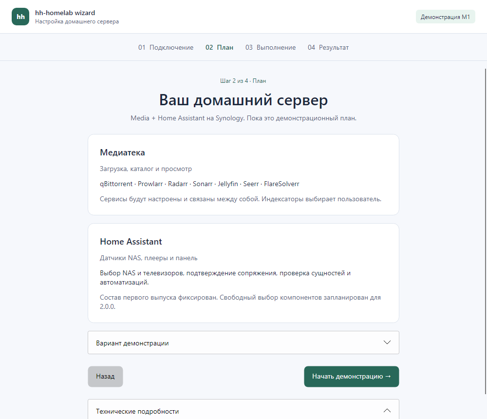

# M1: демонстрационный мастер «Фокус»

Первый каркас реализован, **M1 остаётся открытым до клиентской приёмки**. Это демонстрация интерфейса, без подключения к NAS и установки сервисов. [Решение и зависимости](../adr/0006-desktop-demo.md), [план](../DEVELOPMENT_PLAN.md).



Рендер собственного Win32-окна из DesktopProbe, Windows build 26300. Это снимок работающего демонстрационного приложения; статусы не подтверждают установку на NAS.

## Что можно проверить

1. Укажите пример IP/имени NAS и пользователя; секреты не нужны, адрес не используется для подключения.
2. Откройте демонстрационный план Media + HA. В раскрываемом выборе сценария доступны успех, ошибка Media и потеря ответа.
3. Запустите демонстрацию. На шаге подключения устройств подтвердите её кнопкой; настоящего телевизора не требуется.
4. Проверьте результат либо остановите выполнение. При неизвестном исходе текущая операция не повторяется. «К новой демонстрации» запускает независимый искусственный сценарий.
5. Закройте окно во время выполнения или ожидания: сессия отменяется, закрытие ожидает её завершения.

Прогресс считает шесть демонстрационных групп, не 118 шагов исследовательского профиля M0. Остановка не является откатом; журнал и возобновление ещё не реализованы. Параметры не сохраняются между запусками. Светлая/тёмная тема следует системе, узкое окно использует вертикальную прокрутку.

## Сборка и запуск для разработчика

Нужен SDK 10.0.401 из `global.json`.

```text
dotnet restore HhHomelab.Wizard.slnx --locked-mode
dotnet build HhHomelab.Wizard.slnx --no-restore -c Release
dotnet test HhHomelab.Wizard.slnx --no-build -c Release
dotnet run --project src/HhHomelab.Wizard.Desktop --no-build -c Release
dotnet run --project tools/HhHomelab.Wizard.DesktopProbe --no-build -c Release
```

DesktopProbe — инструмент разработчика: открывает настоящее Win32/X11/Wayland окно, выполняет программные команды сценария на реальном composition root и сохраняет рендеры только собственного окна в `artifacts/native-desktop`. К NAS не обращается. `--expect-backend Win32|X11|Wayland` проверяет фактическую реализацию окна; fallback не может выдать успешный результат нативной Wayland-пробы. Headless тесты отдельно проверяют compiled bindings, мышиные клики, состояние команд, минимальную ширину, темы и масштаб 150%.

## Пробные пакеты

CI публикует папки `hh-homelab-wizard-m1-demo-win-x64` и `hh-homelab-wizard-m1-demo-linux-x64` как артефакты проверки PR на 14 дней, без объявления релиза. Скачайте соответствующий архив из GitHub Actions и распакуйте **всю папку**. Windows 11: запустите `HhHomelab.Wizard.Desktop.exe`. Ubuntu/X11/Wayland: сделайте `chmod +x HhHomelab.Wizard.Desktop`, затем `./HhHomelab.Wizard.Desktop`. .NET, Python и Node.js пользователю не нужны. Native probe и тестовые зависимости в пользовательский артефакт не включаются.

Команды самостоятельной публикации:

```text
dotnet publish src/HhHomelab.Wizard.Desktop -c Release -r win-x64 --self-contained true --no-restore -o artifacts/desktop-win
dotnet publish src/HhHomelab.Wizard.Desktop -c Release -r linux-x64 --self-contained true --no-restore -o artifacts/desktop-linux
```

После локальной публикации для передачи пакета включите `LICENSE`, `LICENSES`, `THIRD_PARTY_NOTICES.md` и [инструкцию пакета](PACKAGE_README.md) под именем `DEMO.md`. CI копирует их автоматически. Инструкция пакета не зависит от относительных ссылок исходной документации.

Ubuntu 24.04 x64 требует X11 либо Wayland-сеанс и системные библиотеки. Общие зависимости и X11:

```sh
sudo apt-get install libx11-6 libice6 libsm6 libfontconfig1 libgl1 fonts-dejavu-core libicu74 libssl3t64 zlib1g
```

Нативный Wayland дополнительно:

```sh
sudo apt-get install libwayland-client0 libwayland-egl1 libxkbcommon0 libegl1 libegl-mesa0 libgles2 libgl1-mesa-dri
```

При заданном `WAYLAND_DISPLAY` общий startup приложения и probe использует Wayland с fallback на X11. В X11-сеансе выбирается X11. Если оба display недоступны, графическое приложение не запускается. Xvfb и Weston нужны только автоматическим пробам CI. Другие дистрибутивы пока не проверены. Системные зависимости и ограничения backend заданы по [Avalonia Linux](https://docs.avaloniaui.net/docs/platform-specific-guides/linux) и [.NET на Ubuntu 24.04](https://learn.microsoft.com/en-us/dotnet/core/install/linux-ubuntu-install#dependencies).

## Результаты и незакрытые проверки

| Проверка | Состояние / граница |
| --- | --- |
| Локальные locked restore/build/tests | 512 unit/fixture + 8 UI проверок прошли на Windows, 2026-10-11 |
| Локальная native self-contained проба | Win32 HWND, Windows 11 Pro build 26300: успех, ошибка, отмена, неизвестный ответ, фактическое закрытие активного окна с отменой/ожиданием; запуск self-contained executable |
| CI Windows runner | Автоматический build/tests/publish + Win32 probe; это Windows Server, не приёмка Windows 11 |
| CI Ubuntu 24.04 | Build/tests/publish; X11 под Xvfb, fallback при недоступном Wayland, нативный Wayland под Weston без DISPLAY; не интерактивная приёмка обычного сеанса |
| Windows 11 x64 | Локальная native проба не закрывает проверку обычной поддерживаемой сборки, разных DPI, клавиатуры и accessibility |
| Ubuntu 24.04 LTS x64 / X11 | Нужен запуск пользователем в обычном сеансе без установленного .NET, проверка масштабирования и ввода |
| Ubuntu 24.04 LTS x64 / Wayland | Нужна отдельная интерактивная проверка, включая ввод, clipboard, DPI и закрытие; Weston CI не подтверждает поведение всех compositor |
| NAS / настоящее сопряжение | Не запускались; относятся к M0/M2 и следующим этапам |

CI-строки описывают состав автоматической проверки; успешность конкретного запуска определяется его отчётом, а не этой таблицей.

Перед закрытием M1 на каждой клиентской ОС запишите редакцию/build, DPI, установлен ли .NET, точный артефакт/commit, результат пяти сценариев выше, управление клавиатурой и отсутствие обрезки при минимальном окне. До этого M2 не считается начатым.

Документ: [CC BY 4.0](../../LICENSES/CC-BY-4.0.txt), © 2026 hhypest.
