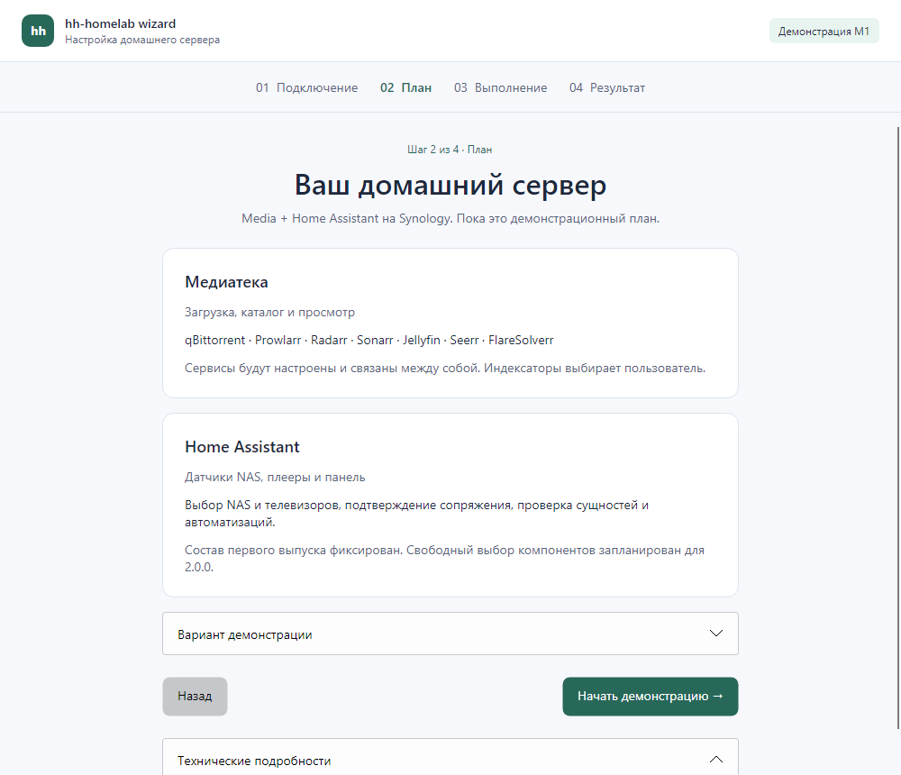

# M1: демонстрационный мастер «Фокус» — сводка этапа

Тип: текущий индекс приёмки этапа M1; автоматические результаты приведены с исходными датами.

[Текущая готовность](../../ROADMAP.md) · [Решение и границы демонстрации](../adr/0006-desktop-demo.md) · [Чек-лист демонстрации](checklists/client-demo.md) · [Сборка и пакеты](../development.md#пробные-пакеты)

Рендер собственного Win32-окна из DesktopProbe, Windows build 26300. Это снимок работающего демонстрационного приложения; статусы не подтверждают установку на NAS.

## Результаты и незакрытые проверки

Владелец подтвердил **полную клиентскую приёмку PR #110 / cac10f0** на Windows 11 26H1 и Ubuntu 24.04.4 LTS / GNOME X11 и GNOME Wayland. [Протокол от 18.10](reports/2026-10-18-m1-owner-check.md) сохраняет предыдущие частичные прогоны и новое явное подтверждение всех клиентских проверок. Автоматические результаты ниже сохраняют исходные даты; их нельзя подменять результатом владельца.

| Проверка | Состояние / граница |
| --- | --- |
| Локальные locked restore/build/tests | 512 unit/fixture + 8 UI проверок прошли на Windows, 2026-10-11 |
| Локальная native self-contained проба | Win32 HWND, Windows 11 Pro build 26300: успех, ошибка, отмена, неизвестный ответ, фактическое закрытие активного окна с отменой/ожиданием; запуск self-contained executable |
| CI Windows runner | Автоматический build/tests/publish + Win32 probe; это Windows Server, не приёмка Windows 11 |
| CI Ubuntu 24.04 | Build/tests/publish; X11 под Xvfb, fallback при недоступном Wayland, нативный Wayland под Weston без DISPLAY; не интерактивная приёмка обычного сеанса |
| Windows 11 x64 | Windows 11 26H1, PR #110 / cac10f0: полностью выполнено и принято владельцем |
| Ubuntu 24.04 LTS x64 / X11 | Ubuntu 24.04.4 LTS / GNOME X11, PR #110 / cac10f0: полностью выполнено и принято владельцем |
| Ubuntu 24.04 LTS x64 / Wayland | Ubuntu 24.04.4 LTS / GNOME Wayland, PR #110 / cac10f0: полностью выполнено и принято владельцем |
| NAS / настоящее сопряжение | Не запускались; относятся к M0/M2 и следующим этапам |

CI-строки описывают состав автоматической проверки; успешность конкретного запуска определяется его отчётом, а не этой таблицей.

При повторении приёмки для новой матрицы/изменённого UI фиксируйте ОС, артефакт/commit, DPI и результаты сценариев. В текущей матрице PR #110 клиентские проверки #42–#45 полностью приняты владельцем. Остаток этапа и аудита — в [ROADMAP](../../ROADMAP.md). Полная приёмка M2 требует закрытия M0/M1; по [ADR 0008](../adr/0008-audit-development-sequence.md) независимые design/fixture инкременты и одноразовый SSH/Docker стенд M2 доступны раньше. Их разработка не разрешает установку на реальный NAS.

## Протоколы этапа

| Протокол | Что зафиксировано |
| --- | --- |
| [Клиентская проверка владельцем — 18.10.2026](reports/2026-10-18-m1-owner-check.md) | Частичные прогоны и полная клиентская приёмка PR #110 / cac10f0 |

Документ: [CC BY 4.0](../../LICENSES/CC-BY-4.0.txt), © 2026 hhypest.
